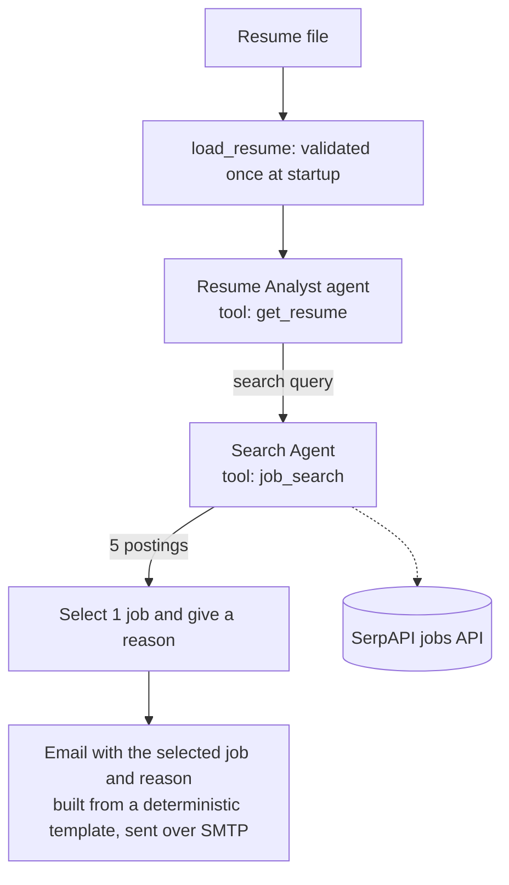

# Design Note: Multi-agent Job Search System (CrewAI)

**Purpose of this note:** record the requirements, design, and trade-offs behind the job-search agent built for the Part 4 capstone, in the form a reviewer or client would want them. Code and run outputs are in the Part 4 repository: [Part_4_Agentic_AI_system](https://github.com/Geeka/Part_4_Agentic_AI_system).

## 1. Problem

A job seeker has to read a resume, work out what to search for, scan postings, and decide which one fits. The system automates that sequence: it reads a resume, derives a search query, retrieves current postings from a job-search API, selects the most relevant one with a reason, and emails the result.

**Use case.** Individual job seekers, and career-services or placement teams that must match many candidates to live roles. Searching boards by hand is slow, and many results are staffing-agency or generic adverts. The agent turns a resume into a targeted query, retrieves current postings, and returns one recommended match with a reason. The testing below found exactly this noise (staffing-agency picks), and time saved was not measured.

## 2. Requirements

| # | Requirement | Status |
|---|---|---|
| R1 | Read a local resume and derive a search query | Met |
| R2 | Retrieve current postings from a job-search API | Met (SerpAPI Google Jobs API, last 7 days, 5 results) |
| R3 | Select one relevant posting and state the reason | Met |
| R4 | Email the selected job and the reason for the choice | Met (SMTP, deterministic template) |
| R5 | Include all five listings, with apply links, in the email | Attempted, not completed |
| R6 | Tool failures must not crash the run | Met (the job-search tool returns an error object instead of raising) |
| R7 | Every tool call must be logged | Met (structured log in `agents_outputs.json`) |
| R8 | Produce an ATS-friendly resume and cover letter tailored to the selected job | Attempted, not completed |

## 3. Architecture

Secrets (API keys, SMTP credentials) are read from environment variables and are not stored in the repository.

## 4. Tool contracts

| Tool | Input | Output | Type | Failure behaviour |
|---|---|---|---|---|
| `get_resume` | none | Full resume text | Read | Cannot fail mid-run, because the resume is validated once at startup |
| `job_search` | `query: str` | JSON list of postings (title, company, location, description, apply link) | Read | Catches exceptions and returns `{"error": "..."}` |

Both tools were designed to be clear, accurate about their side effects (none), atomic (one responsibility), and safe (no raised exceptions during a run).

## 5. Orchestration decision

Two process designs were run on the same task, once for each of 10 resumes (20 runs).

| | Sequential | Hierarchical |
|---|---|---|
| Flow | Fixed order: analyze the resume, then search | A manager agent (`jobs_manager`) with `allow_delegation=True` |
| Good matches (manual score of 4 or more out of 5) | 8 of 10 | 5 of 10 |
| Average score | 4.0 | 3.6 |
| Search calls per run | 1.4 on average (1 to 3) | 1.9 on average (1 to 5) |
| Delegation | Not applicable | The manager delegated in 2 of 10 runs |

**Delivered configuration: sequential.** The task is a linear pipeline with no routing decision, so a fixed order is predictable and easy to reproduce. In this test it also produced more good matches. The hierarchical manager delegated in only 2 of 10 runs, so the extra layer added searches without adding routing.

## 6. Observability

Tool calls are captured through CrewAI's native tool-usage events and written to `agents_outputs.json` with the tool name, parsed arguments, and agent role. This made the hallucinated tool name and the call counts above visible.

## 7. Testing and evaluation

Ten synthetic resumes were used: entry-level data analyst, BI analyst, digital marketing analyst, backend engineer, frontend developer, financial analyst, HR recruiter, supply chain analyst, associate product manager and junior data scientist. Both crews ran on each, giving 20 runs.

Each chosen job was scored by hand out of 5: title match (0 to 2), level match (0 to 2) and real employer (0 to 1). A score of 4 or more counts as a good match. Result: **13 of 20 good matches** (sequential 8 of 10, hierarchical 5 of 10). The scoring guide and every run's score are in `evaluation/`.

- **Reliability:** all 20 runs ended with an emailed result. Two resumes needed one rerun: one run stopped before searching, and one failed with a JSON parse error on the model's reply.
- **Common failures:** staffing-agency or generic postings; level mismatches (searches for "junior" roles for candidates with 2 years of experience produced an internship pick); a listing whose company name did not fit the role; US-only postings for candidates in India.
- **Summary accuracy:** in one run the summary step overstated a candidate's experience (3+ years against 2).
- **Link check:** when opened later, some postings had been taken down and some aggregators needed a sign-in. Aggregator listings expire quickly.
- **Limits:** scores come from titles, companies and level wording, not from reading every posting in full. Ten resumes is a small sample, so the results describe behaviour and are not an accuracy estimate.

## 8. Limitations and next steps

- **Guardrails for the sequential flow:** validate tool names, cap the number of search calls, and reject empty result sets, to capture what hierarchical mode did better.
- **Quality filter:** screen out generic staffing-agency postings before selection.
- **Level and location:** map years of experience to a level in the query, and pass the candidate's location, so searches stop defaulting to "junior" roles and US postings.
- **Evaluation:** score matches against a labelled set of resumes and postings, so matching quality can be measured.
- **R5 and R8 (attempted, not completed):** emailing all five listings with apply links, and generating an ATS-friendly resume and cover letter tailored to the selected job. They are listed here as future work, not claimed as features.
- **Delegation:** test a design where the manager has a real routing decision, for example separate search agents per region.
